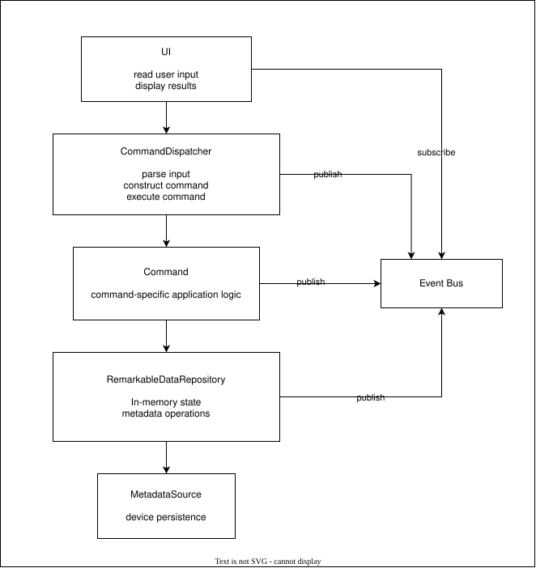
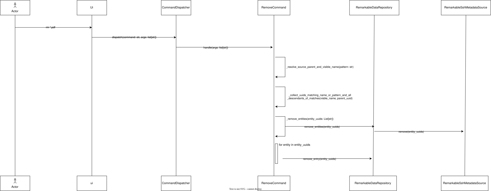

# Project architecture

The application follows a layered architecture in which user interaction, command processing, application-specific logic, in-memory state management, and device persistence are separated into distinct components.

The main components and their responsibilities are:

- **UI** – Provides the user interface. It reads user input, forwards it to the command dispatcher, subscribes to events published through the event bus, and displays the results.

- **CommandDispatcher** – Acts as the entry point for command execution. It parses user input, constructs the corresponding command, and executes it. Command-specific application logic is delegated to the appropriate command implementation.

- **Command** – Encapsulates command-specific application logic. Each command implements the functionality associated with a particular user operation. Commands can publish events through the event bus to notify other components about relevant changes.

- **RemarkableDataRepository** – Maintains the application's in-memory representation of the reMarkable device state. It provides operations for accessing and modifying metadata and publishes events when relevant state changes occur.

- **MetadataSource** – Provides persistence of metadata on the reMarkable device. It is responsible for the device-specific persistence operations used to maintain the metadata representation.

- **Event Bus** – Provides a mechanism for communication between components through a publish-subscribe model. Components can publish events without having direct dependencies on their subscribers. The UI and other interested components can subscribe to events and react accordingly.

The general execution flow begins when the user enters a command through the UI. The CommandDispatcher parses the input, constructs the appropriate command, and executes it. The command performs its application-specific operations, interacting with the RemarkableDataRepository when necessary.

The repository maintains the in-memory state and coordinates metadata operations with the MetadataSource. Changes can be communicated to other components through the Event Bus. This allows interested subscribers, including the UI, to react to changes without requiring direct dependencies between the command implementations and the presentation layer.

This separation of responsibilities keeps command-specific functionality independent of the user interface, centralizes application state management, and isolates device persistence from the rest of the application.

## Case study - remove command

This case study details the happy path of the `rm` (remove) command. The user invokes the command with the argument `*.pdf`, which results in the removal of all documents whose visible names end with the `.pdf` extension from the current working directory.

The execution begins when the user enters `rm *.pdf` in the UI. The UI forwards the command and its arguments to `CommandDispatcher` through `dispatch(command: str, args: list[str])`. The dispatcher identifies the appropriate command implementation and invokes `RemoveCommand` through `handle(args: list[str])`.

The `RemoveCommand` encapsulates the application-specific logic for removing entries. It first resolves the supplied pattern by calling `_resolve_source_parent_and_visible_name(pattern: str)` inherited from command base class `BaseCommand`. This determines the source parent and visible name used to identify matching entries from in-memory device metadata state stored in `RemarkableDataRepository`.

Next, the command calls `_collect_uuids_matching_name_or_pattern_and_all_descendants_of_matches(visible_name, parent_uuid)` to collect the UUIDs of all matching entries, including their descendants. This ensures that removing a directory also accounts for its contents.

Once the matching UUIDs have been collected, `RemoveCommand` delegates the removal operation to `RemarkableDataRepository` by calling `_remove_entities(entity_uuids: List[str])`. The repository then forwards the request to `RemarkableSshMetadataSource` through `remove(entity_uuids)`, which performs the actual removal on the reMarkable device.

After the device removal operation, the repository updates its in-memory representation to reflect the changes. It iterates over the collected UUIDs and removes the corresponding entries using `remove_entry(entity_uuids)`.

The operation therefore involves three distinct responsibilities: `RemoveCommand` determines which entries should be removed, `RemarkableDataRepository` coordinates the removal and maintains the in-memory state, and `RemarkableSshMetadataSource` handles the device-specific persistence operation.

In this happy path, information flows from the UI towards the reMarkable device and through the corresponding components. The repository also updates its in-memory state following the device removal. No response needs to be propagated back through the invoking layers, as the command does not require further processing of the device response.

